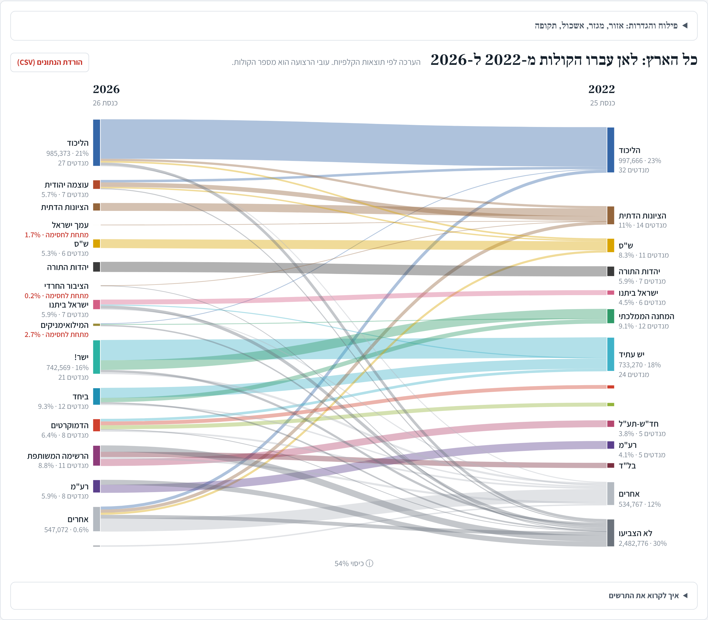

# Knesset Vote Flows

**Who moved to whom between Israeli elections, 2013–2026, estimated from ballot-box results.**

The vote is secret, but the Central Elections Committee publishes results for each of about 12,000 ballot boxes. The same neighbourhoods vote in roughly the same boxes every election, so the differences between boxes say a lot about who switched where. This project turns those differences into a transfer matrix (what share of each party's voters went to each party, or stayed home) for the whole country, for every large city, for four sectors (Haredi, Arab, Druze, general) and for socioeconomic clusters.

On the night of the 2026 election it ran live: the results file was downloaded every two minutes, the estimates were recomputed in about 20 seconds, and the page and its headline cards updated themselves until the count ended.

**Live site (Hebrew):** https://orenl833-tlv.github.io/knesset-vote-flows/
(also on claude.ai: [2013–2026, election night edition](https://claude.ai/artifact/9mV89K4g8dSPcKYNKnyQU3) · [2013–2022](https://claude.ai/artifact/BCTFfnxbxmSaC4kxwg3AgC))

**The post about it, with the maths:** [LinkedIn](https://www.linkedin.com/feed/update/urn:li:activity:7520510892862500864/)



## Some findings from 2026

- **No real movement between the blocs.** Net, only about 26 thousand voters crossed from Netanyahu's bloc to the anti-Netanyahu bloc (Arab lists aside). The anti-Netanyahu bloc grew by bringing in about 152 thousand people who had not voted in 2022.
- **Eisenkot's Yashar! was built on Lapid's voters:** about 57% of its votes came from 2022 Yesh Atid voters and about 27% from Gantz's National Unity.
- **Bennett inherited from Gantz, not from the right:** only about 3% of Beyachad's votes came from 2022 voters of Likud, Religious Zionism, Shas or UTJ.
- **Likud bled to the right, not to the left:** about 82% of its 2022 voters stayed. Of those who left, the largest groups went to small lists and to Ben Gvir's Otzma Yehudit.
- **Ben Gvir took about 23% of Religious Zionism's 2022 voters,** and about 9% of Shas's.
- **The Arab lists kept their own camps:** almost no votes moved between the Joint List and Ra'am.

Every estimate on the site comes with a bootstrap interval. The headline cards are written automatically from the flows, and skip moves whose interval is too wide to say anything.

## How it works

1. **Match ballot boxes between elections.** Box numbers change between elections, and whole neighbourhoods are rebuilt. A box (or a polling place, from 2019 on) is compared only when its number of eligible voters barely changed. Boxes where the Haredi or Arab vote share jumped sharply are dropped as likely population replacement.
2. **Fit a transfer matrix in each city.** For each box, *x* is its 2022 vote shares and *y* its 2026 shares. Find the matrix *P* that makes *x·P* as close as possible to *y* across all boxes, where every row of *P* is a probability distribution (no negative shares; each row sums to 100%). This is constrained least squares, solved with FISTA (accelerated projected gradient) and projection onto the probability simplex.
3. **Add up.** City matrices are scaled to their voters and summed into national, sector and cluster results. Smaller localities are pooled by district and type.
4. **Measure uncertainty.** A bootstrap over ballot boxes (1,000 resamples for the final run) gives a 90% interval for every flow.
5. **Check against a survey.** The main flows were compared with the Israel National Election Studies (INES), where voters are asked how they voted in both elections. They agree on the main moves: for example, Likud to Religious Zionism in 2022 is 11% here and 12% in the survey. See [`config/ines_comparison.md`](config/ines_comparison.md).

**Known limits.** This is ecological inference: it sees *net* moves inside a box well but misses swaps that cancel out (one voter goes A→B, another B→A), so it overstates loyalty. It is weakest in very mixed cities such as Jerusalem. Double-envelope votes (soldiers, diplomats and others) count in the seats but not in the flows, since they have no 2022 box to compare with.

## Repository map

| Path | What it is |
|---|---|
| `scripts/solver.py` | the FISTA solver for the simplex-constrained least squares |
| `scripts/matching.py`, `pipeline.py`, `regions.py`, `model.py` | box matching, filters, sectors, regions and model inputs |
| `scripts/stage1.py` → `stage2.py` → `stage3.py` | 2013–2022: data prep and diagnostics → fits, bootstrap and web data → socioeconomic clusters |
| `scripts/live_update.py` | the 2022→2026 pair on a partial or full count (election night) |
| `scripts/headlines26.py` | turns the 2026 flows into short Hebrew headline cards, merging duplicates and checking intervals |
| `live/fetch.py`, `live/night.sh` | the election-night downloader and the one-command rebuild |
| `live/seats.py` | Knesset seats by the Bader-Ofer method with surplus-vote agreements |
| `web/index.html` | the page (D3 Sankey-style chart, map, seat bars, cards) |
| `data/raw/` | per-ballot results for Knesset 19–26 and the CBS locality and socioeconomic files |
| `design/` | the specifications the pipeline was built to |
| `docs/` | the built site served by GitHub Pages |

## Running it

Python 3 with `numpy`, `pandas`, `scipy`, `openpyxl` (`pip install -r requirements.txt`). Node with Playwright only for the share images.

```bash
# rebuild the 2022→2026 analysis and the site from the final 2026 file (about half a minute)
K26=data/raw/k26.csv bash live/night.sh --final

# the published run, with 1,000 bootstrap resamples (about an hour on 4 cores)
K26=data/raw/k26.csv bash live/night.sh --boot 1000 --final

# the 2013–2022 elections from scratch
python3 -I scripts/download.py
python3 -I scripts/stage1.py && python3 -I scripts/stage2.py --boot 200 && python3 -I scripts/stage3.py
python3 -I scripts/build_site.py
```

The site is written to `out/site_live/` (and `out/site/` for 2013–2022). To update the Pages site, run `python3 -I scripts/build_pages.py` (copies `out/site_live/` into `docs/` and adds the page skeleton).

## Data sources

- Ballot-box results: Central Elections Committee, via [data.gov.il](https://data.gov.il). On the 2026 election night, the committee's file was read through the public mirror [k26-turnout-live](https://github.com/OmerCohenBI/k26-turnout-live). The committee's final tally moved about 100 votes from invalid to valid after review, which changes no seat.
- Locality type, district, religion and socioeconomic cluster: Central Bureau of Statistics.
- Validation: INES (Israel National Election Studies).

## Built with

Planned, built and checked with Claude Code. I decided what to build, checked that the numbers made sense, and dug in whenever a number looked off; that is how the box-matching problems and the bloc-grouping problem (see the LinkedIn post) were found.
